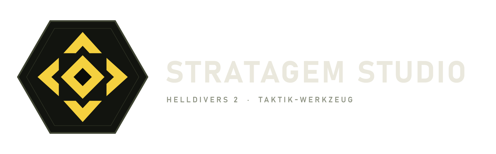
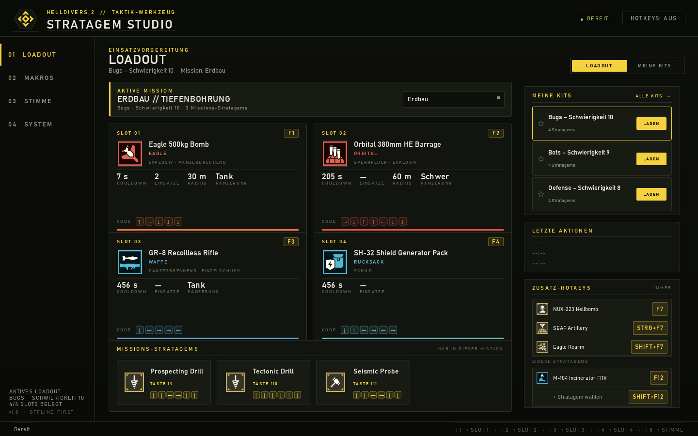
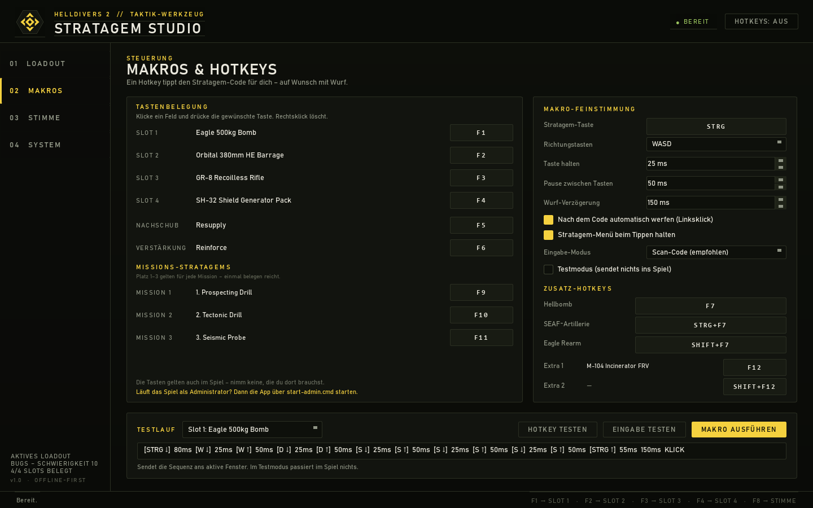
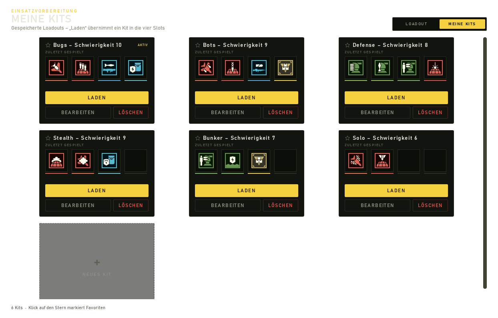
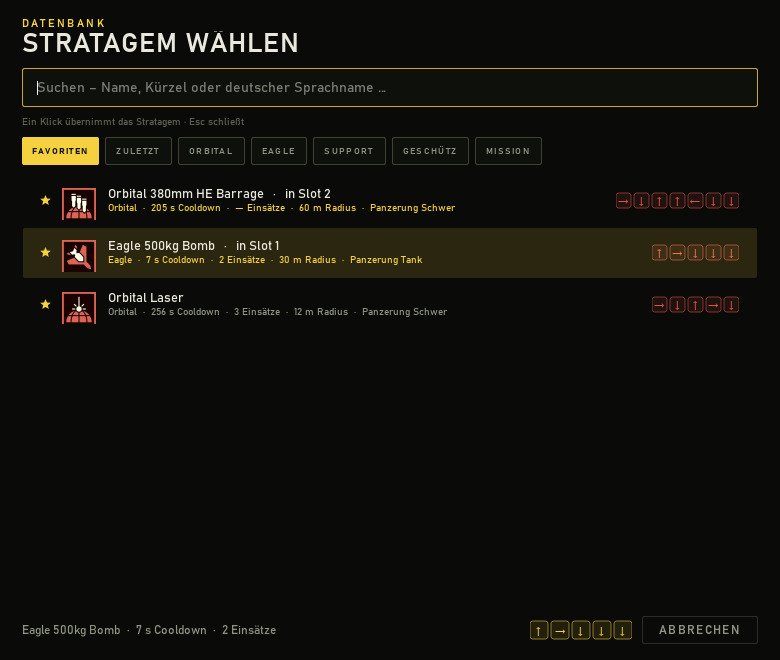

# Stratagem Studio

[](https://github.com/zenkaro1/Helldivers-2-Stratagem-Studio/actions/workflows/tests.yml)
[](https://github.com/zenkaro1/Helldivers-2-Stratagem-Studio/actions/workflows/release.yml)
[](LICENSE)



Lokales Desktop-Tool für **Helldivers 2**: Loadout zusammenstellen, Stratagem-Codes als
Makro auf Hotkeys legen und die eigenen Stratagems per **Push-to-Talk** ansagen.

Kein Overlay-Cheat, kein Eingriff ins Spiel – das Tool tippt nur Tastenkombinationen,
so wie du sie auch selbst tippen würdest.

## Download

Fertige Windows-Version (kein Python nötig): **[Releases](https://github.com/zenkaro1/Helldivers-2-Stratagem-Studio/releases)**
→ `StratagemStudio-Setup.zip` herunterladen, entpacken, `Installieren.cmd` doppelklicken.
Die ZIP enthält die App inkl. Sprachmodellen; Einstellungen liegen danach in
`%LOCALAPPDATA%\Programs\StratagemStudio\userdata`.



## Logo

Das Zeichen — ein Stratagem-Kompass aus Hexagon, vier Richtungs-Chevrons und
Diamant-Kern — ist in **VectorCraft** über den MCP-Server gebaut und liegt als SVG/PNG
in `design/exports/logo/`. Details und Farben: [design/LOGO.md](design/LOGO.md).
Es sitzt oben links im App-Kopf und dient als Fenster-, Taskleisten- und Tray-Icon
(`app/assets/logo.png` + `logo-mark.png`).

## Funktionen

- **Stratagem-Datenbank** mit 117 Einträgen (alle Offensiv-, Defensiv-, Support- und
  Missions-Stratagems inkl. Resupply, Verstärkung, SOS-Bake), jeweils mit Icon,
  Eingabecode, Cooldown und Freischalt-Info.
- **Loadout-Builder** im Stats-Layout: **Cooldown, Einsätze, Radius (AoE) und
  Panzerung** groß auf der Karte (Panzerung in Worten: Leicht, Mittel, Schwer, Tank,
  Tank II), darunter die **Traits** (Explosiv, Panzerbrechend, Sperrfeuer, Napalm, …);
  der Eingabecode nur als dezente Zeile.
- **Missionen**: Erdbau, Flagge hissen, SSSD, Nestsprengung, Dunkle Flüssigkeit. Die
  passenden **Missions-Stratagems** (z. B. Prospecting Drill, Tectonic Drill,
  Seismic Probe) erscheinen automatisch und belegen keinen der vier Loadout-Slots.
- **Zusatz-Hotkeys**: NUX-223 Hellbomb, SEAF-Artillerie und Eagle-Rearm hängen an
  keiner Mission – sie haben eigene Tasten (`F7`, `Strg+F7`, `Shift+F7`) und stehen im
  Loadout im Feld „Zusatz-Hotkeys“.
- **Eigene Stratagems** (z. B. Event-Waffen wie den Incinerator FRV): zwei freie
  Plätze unter „Eigene Stratagems“ im gleichen Feld. Klick auf „+ Stratagem wählen“
  öffnet den Picker, die Taste (`F12`, `Shift+F12`) steht daneben und lässt sich in
  den Makros ändern. Sie brauchen keinen Loadout-Slot und sind immer verfügbar.
- **Kits**: mehrere gespeicherte Loadouts mit Favoriten-Stern, „Laden“ übernimmt ein
  Kit in die vier Slots. Umschalten über die Tabs `LOADOUT | MEINE KITS` oben rechts
  oder über „ALLE KITS →“ im rechten Panel.
- **Picker** mit Kategorien (Orbital, Eagle, Geschütz, Support, Mission),
  **Favoriten** und **Zuletzt gespielt**, Suche und Stats pro Zeile.
- **Schiff-Upgrades**: Im System-Tab trägst du ein, welche Super-Destroyer-Module du
  hast. Die neun cooldown-relevanten Module (u. a. Zero-G Breech Loading,
  Liquid-Ventilated Cockpit, Morale Augmentation, Expanded Weapons Bay) senken
  Cooldowns bzw. erhöhen Eagle-Nutzungen – multiplikativ und sofort auf Karten,
  Picker und Cooldown-Leiste.
- **Makros**: pro Slot ein globaler Hotkey (Standard `F1`–`F4`, `F5` Nachschub,
  `F6` Verstärkung) plus frei belegbare Hotkeys für die Missions-Stratagems.
- **Sprachsteuerung**: Push-to-Talk-Taste halten, Stratagem ansagen
  („Adler fünfhundert Kilo“, „Nachschub“, „Slot zwei“), lokale Transkription mit
  faster-whisper, danach wird das passende Stratagem ausgeführt.
- **Feintuning**: Tastendauer, Pausen, Wurf-Verzögerung, WASD oder Pfeiltasten,
  Scan-Code- oder VK-Modus, Testmodus ohne Eingaben ans Spiel.
- **Overlay & Tray**: kurze Bestätigung über dem Spiel, App läuft minimiert im
  Infobereich weiter.


| Makros | Kits | Picker |
| --- | --- | --- |
|  |  |  |

## Wenn Makros nicht auslösen

0. **Läuft die App mit „niedrigen Rechten“?** Das ist der häufigste Grund, wenn
   Hotkeys nur im App-Fenster, aber nie im Spiel funktionieren. Ursache: Die Dateien
   wurden von einem eingeschränkten Prozess erzeugt und tragen die
   Integritätsstufe **Niedrig** – Windows lässt einen solchen Prozess weder
   Tastatur-Hooks noch `SendInput` gegenüber einem normalen Spiel zu (UIPI).
   Prüfen: `icacls dist\StratagemStudio\StratagemStudio.exe` – steht dort
   „Niedrige Verbindlichkeitsstufe“, dann [fix_integrity.cmd](fix_integrity.cmd)
   **als Administrator** ausführen (oder den Ordner `dist\StratagemStudio` per
   Explorer auf den Desktop kopieren und dort starten). Die App zeigt bei
   niedrigen Rechten beim Start einen Hinweis.
1. **Läuft Helldivers 2 als Administrator?** Dann die App über
   [start-admin.cmd](start-admin.cmd) ebenfalls erhöht starten. Windows blockiert
   sonst sowohl die Hotkey-Erkennung als auch die gesendeten Tasten (UIPI).
2. **„Stratagem-Menü beim Tippen halten“ muss angehakt sein.** Ohne die gehaltene
   STRG-Taste tippt das Makro nur WASD – das Spiel empfängt keine Stratagem-Eingabe.
3. **„HOTKEY TESTEN“** im Makros-Screen: 8 Sekunden warten, Taste drücken – der
   Dialog sagt, ob die App die Taste sieht (auch im Hintergrund).
4. **„EINGABE TESTEN“** prüft, ob SendInput überhaupt Tasten senden darf.
5. Jeder Makro-Lauf wird in `macro.log` neben der `settings.json` protokolliert
   (`hotkey pressed`, `hotkey triggered`, `start` mit `dry_run`, Fehler). Fehlt dort
   ein Eintrag, wurde der Hotkey nicht erkannt.
6. Timing bei verschluckten Eingaben erhöhen: „Taste halten“ 30–40 ms, „Pause“ 60–80 ms.

## Auf GitHub veröffentlichen

Alles ist vorbereitet — du brauchst nur ein leeres Repository und einen Push:

1. Auf [github.com/new](https://github.com/new) ein **leeres** Repo anlegen
   (ohne README/.gitignore), z. B. `Helldivers-2-Stratagem-Studio`.
2. `publish-to-github.cmd` doppelklicken, Repository-URL bestätigen.
   Das Skript committet alles, setzt `origin` und pusht nach `main`.
3. Release bauen: `make-release.cmd` (z. B. `v1.0.0`). Der Tag startet die
   GitHub-Action, die die EXE baut und `StratagemStudio-Setup.zip` ans
   Release hängt.

Enthalten:

- `.github/workflows/tests.yml` – Tests bei jedem Push/PR
- `.github/workflows/release.yml` – EXE + Setup-ZIP bei Tag `v*`
- `packaging/` – Installer, Deinstaller und Liesmich für die ZIP

## Weitergeben (Setup-ZIP)

`dist\StratagemStudio-Setup.zip` (ca. 130 MB) ist das Paket für Freunde:

```
StratagemStudio-Setup\
  Installieren.cmd      kopiert nach %LOCALAPPDATA%\Programs\StratagemStudio,
                        entfernt die Downloadsperre, legt Desktop- und
                        Startmenü-Verknüpfung an
  Deinstallieren.cmd    entfernt Programm, Verknüpfungen und Einstellungen
  LIESMICH.txt          Anleitung inkl. SmartScreen-Hinweis
  StratagemStudio\      die App (EXE + _internal)
```

Empfänger muss nur entpacken und `Installieren.cmd` doppelklicken — kein Python,
keine Installation von Abhängigkeiten. Windows 10/11 x64, ca. 330 MB auf der Platte.
Die EXE ist nicht signiert, SmartScreen kann einmal „Weitere Informationen →
Trotzdem ausführen“ verlangen.

## EXE bauen

Solange die App über `pythonw -m app` läuft, zeigt die Windows-Taskleiste das
**Python-Icon**: die Taskleiste nimmt das Icon der laufenden EXE, nicht das
Fenster-Icon. Erst ein gepackter Build bekommt sein eigenes Icon.

```bat
build_exe.cmd
```

Das Skript installiert PyInstaller und baut einen **Ordner-Build**:

```
dist\StratagemStudio\StratagemStudio.exe
dist\StratagemStudio\_internal\…
```

Der ganze Ordner ist die App (ca. 330 MB, inkl. PySide6 und der Sprachmodelle
faster-whisper/ctranslate2/onnxruntime). Zum Weitergeben den Ordner kopieren oder
zippen; `StratagemStudio.exe` darin starten. Einstellungen, Loadouts und Modelle
landen neben der EXE in `userdata\`.

Enthalten: `data\` (Stratagems, Missionen, Schiffsmodule, Icons), `app\assets\`
(Logo/Icon) und die Sprachmodule. Taskleiste, Alt-Tab und Startmenü zeigen danach
das Stratagem-Studio-Zeichen.

Damit ein Build sauber läuft, ist `app/paths.py` bereits auf „frozen“ vorbereitet:
Daten kommen aus dem Bundle, Einstellungen/Loadouts liegen neben der EXE
(`userdata\`), und die AppUserModelID wird vor dem Qt-Start gesetzt.

## Wenn der Start nicht klappt

Die App schreibt beim Start nichts ins Leere: Schlägt etwas fehl, erscheint ein
Windows-Dialog mit dem Fehler, und derselbe Text landet in
`%APPDATA%\HD2StratagemStudio\crash.log` (bzw. im Ordner `userdata` neben dem
Programm, wenn `%APPDATA%` nicht beschreibbar ist).

1. `debug.cmd` ausführen – dort bleibt die Konsole offen und zeigt den Traceback.
2. Prüfen, ob `%APPDATA%\HD2StratagemStudio` existiert und beschreibbar ist. Ist der
   Ordner defekt, löschen – die App legt ihn neu an und weicht notfalls auf
   `userdata` aus.
3. Wenn Antivirus/EDR das Python-Programm blockiert: Ausnahme für den Projektordner
   setzen.

## Installation

Voraussetzungen: Windows 10/11, Python 3.10+ (getestet mit 3.13).

```bat
cd hd2-stratagem-studio
python -m venv .venv
.venv\Scripts\python.exe -m pip install -r requirements.txt
start.cmd
```

`start.cmd` erledigt die Einrichtung beim ersten Start selbst und startet die App ohne
Konsolenfenster. Für die Fehlersuche gibt es `debug.cmd` (mit Konsole).

## Bedienung

### 1. Loadout

- **Mission wählen**: oben in der Missionsleiste (z. B. Erdbau) – die passenden
  Missions-Stratagems erscheinen darunter und lassen sich per Klick oder Hotkey
  auslösen. Sie belegen keinen der vier Slots.
- Auf einen Slot klicken → Picker mit Kategorien, Favoriten und „Zuletzt“.
  Ein Klick übernimmt das Stratagem sofort (Enter geht auch). Dasselbe Stratagem
  lässt sich nicht in zwei Slots legen – der Picker markiert es mit „in Slot X“.
- Rechtsklick auf einen belegten Slot entfernt ihn.
- Die Karten zeigen **Cooldown, Einsätze, Radius und Panzerung** plus die
  Traits (Explosiv, Panzerbrechend, Sperrfeuer …); der Code steht klein darunter.
  Das Freischalt-Level wird bewusst nicht angezeigt – wer das Makro nutzt, hat das
  Stratagem längst. Die Werte sind Näherungen und stehen als `radius`, `ap` und
  `traits` in `data/stratagems.json`.
- **Eagle-Nutzungen** werden mitgezählt: Jeder Wurf kostet eine Ladung, bei 0 läuft
  der Rearm-Cooldown und danach sind alle Ladungen wieder da (Expanded Weapons Bay
  gibt +1).
- **Kits**: Tab `MEINE KITS` oben rechts (oder „ALLE KITS →“ im rechten Panel).
  `LADEN` übernimmt ein Kit in die vier Slots und springt zurück zum Loadout,
  `BEARBEITEN` benennt es um, der Stern markiert Favoriten, `LÖSCHEN` entfernt es
  nach einer Rückfrage (mindestens ein Kit bleibt erhalten). Rechtsklick auf eine
  Kit-Zeile im Seitenpanel bietet Laden/Umbenennen/Löschen. Das Raster ist
  scrollbar und zeigt beliebig viele Kits.

### 2. Makros

- Hotkey-Feld anklicken und die Wunschtaste drücken; Rechtsklick löscht die Belegung.
- **Doppelte Belegungen** (auch Push-to-Talk) meldet die App als Fehler-Popup –
  sonst würde eine der beiden Aktionen nie auslösen.
- Standard: `F1`–`F4` für die Slots, `F5` Nachschub, `F6` Verstärkung.
- **Missions-Stratagems** haben drei feste Plätze (`F9`–`F11`). Einmal belegen, gilt
  für jede Mission: Platz 1 ist immer das erste Stratagem der aktiven Mission, egal ob
  Super-Earth-Flagge, Prospecting Drill oder etwas anderes. Kein Umkonfigurieren pro
  Mission.
- **Zusatz-Hotkeys** (Hellbomb `F7`, SEAF-Artillerie `Strg+F7`, Eagle-Rearm `Shift+F7`)
  sind unabhängig von der Mission und immer verfügbar.
- „Stratagem-Taste“ ist standardmäßig `STRG` – das ist die Taste, die im Spiel das
  Stratagem-Menü öffnet. Wenn du sie im Spiel geändert hast, hier anpassen.
- „Richtungstasten“: `WASD` (Standard) oder Pfeiltasten.
- „Nach dem Code automatisch werfen“ schickt einen Linksklick hinterher. Ohne diese
  Option bleibt die Stratagem-Kugel in der Hand und du wirfst selbst.
- **Cooldown-Sperre** (System → „Stratagems im Cooldown nicht auslösen“, Standard
  **aus**): eingeschaltet sendet ein Hotkey nichts, solange der (ggf. durch
  Schiff-Upgrades verkürzte) Cooldown oder ein Eagle-Rearm läuft. Ausgeschaltet sendet
  er immer – auch wenn die App noch einen Cooldown anzeigt.
- Der Testlauf zeigt die komplette Sequenz und kann sie – mit aktivem Testmodus –
  ohne Auswirkung auf das Spiel durchspielen.

### 3. Stimme

- **Push-to-Talk** (Standard `F8`) halten und sprechen, loslassen zum Auswerten.
- Backend „Lokal (faster-whisper)“ läuft offline auf der CPU. Beim ersten Start wird
  das Modell einmalig heruntergeladen (`tiny` ≈ 75 MB, `base` ≈ 145 MB,
  `small` ≈ 480 MB). `small` ist der gute Kompromiss für Deutsch.
- Alternativ „OpenAI-kompatible API“ (OpenAI, Groq, …): Basis-URL, Modell und
  API-Schlüssel eintragen – dann läuft die Erkennung in der Cloud.
- „Nur Stratagems aus dem aktiven Loadout erkennen“ verhindert Verwechslungen; die
  Treffer-Schwelle lässt sich zwischen 0.40 und 0.92 einstellen.
- **Eigene Keywords**: „EIGENE KEYWORDS“ im Stimme-Screen öffnet die Verwaltung.
  Dort legst du pro Stratagem Begriffe an, die du tatsächlich sagst — z. B. „380“
  oder „dickes Sperrfeuer“ für die 380-mm-HE-Barrage. Sie zählen zusätzlich zu den
  eingebauten Namen, sind unabhängig von Groß-/Kleinschreibung und landen in
  `settings.json` (`custom_aliases`).
- Passt ein Begriff zu einem Stratagem, das **nicht im aktiven Loadout** liegt, steht
  im Verlauf „nicht im aktiven Loadout: <Name>“ statt „nicht erkannt“ — und das
  Overlay zeigt denselben Hinweis. So siehst du sofort, ob der Befehl falsch war oder
  nur das Stratagem fehlt.
- Beispiele: „Adler fünfhundert Kilo“, „380er Sperrfeuer“, „Nachschub“,
  „Verstärkung“, „Orbitaler Laser“, „Slot zwei“.

Die Erkennung versteht Englisch und Deutsch (deutsche Begriffe sind als Alias
hinterlegt, keine offizielle Übersetzung) und normalisiert Zahlen und Einheiten
(„500 kg“ = „500kg“). Eigene Aliase lassen sich in `data/stratagems.json` ergänzen.

## Schiff-Upgrades (Cooldowns)

Im System-Tab unter **„Schiff-Upgrades“** hakst du ab, welche Module dein Zerstörer hat.
Hinterlegt sind die neun Module, die Cooldowns oder Eagle-Nutzungen beeinflussen
(Quelle: [Helldivers Wiki – Ship Modules](https://helldivers.wiki.gg/wiki/Ship_Modules)):

| Modul | Wirkung |
| --- | --- |
| Streamlined Request Process | Support-Waffen −10 % Cooldown |
| Hand Carts | Rucksäcke & Fahrzeuge −10 % |
| Zero-G Breech Loading | Orbital −10 % |
| Liquid-Ventilated Cockpit | Eagle −50 % (Rearm) |
| Pit Crew Hazard Pay | Eagle-Rearm −20 % |
| Advanced Crew Training | Eagle-Rearm −10 % (nur mit Restnutzungen) |
| Expanded Weapons Bay | +1 Eagle-Nutzung |
| Morale Augmentation | alle Stratagems −5 % |
| Synthetic Supplementation | Geschütze, Stellungen, Resupply −10 % |

Die Reduktionen werden **multiplikativ** verrechnet (z. B. 240 s × 0,9 × 0,95 = 205 s)
und wirken überall: Slot-Karten, Picker und die lokale Cooldown-Leiste. Die Daten
stehen in `data/ship_modules.json` und lassen sich dort ergänzen.

## Wie die Makros funktionieren

1. `STRG` gedrückt halten (Menü öffnen),
2. Code als Tastenfolge tippen, z. B. `↑ → ↓ ↓ ↓` für die 500-kg-Bombe,
3. `STRG` loslassen,
4. optional Linksklick zum Werfen.

Die Tasten werden über `SendInput` mit Scan-Codes gesendet, damit das Spiel sie wie
echte Hardware-Eingaben liest. Timing und Reihenfolge sind in den Makro-Einstellungen
justierbar, falls eine Sequenz im Spiel „verschluckt“ wird (typisch: Tastendauer etwas
erhöhen).

> **Hinweis:** Makros und Sprachsteuerung sind Komfortfunktionen. Nutzung auf eigene
> Verantwortung; Anticheat-Systeme können automatisierte Eingaben als auffällig
> bewerten. Das Tool steht in keiner Verbindung zu Arrowhead oder Sony und liest
> keine Spielspeicher-Daten aus.

## Datenbank aktualisieren

Die Stratagem-Liste stammt aus der Community-Wiki und liegt als JSON im Projekt:

```bat
python tools/build_stratagem_db.py   :: Wiki-Seite einlesen
python tools/build_db.py             :: kuratieren + Icons laden
```

Neue Stratagems erscheinen danach automatisch in der App („Datenbank neu laden“ unter
Einstellungen). Icons liegen als SVG in `data/icons/`.

## Projektstruktur

```
app/
  main.py              Einstiegspunkt (Qt-App, Wiring)
  context.py           Controller: Loadout, Makros, Hotkeys, Stimme
  core/
    models.py          Stratagem / Loadout / Settings
    database.py        Laden, Suche, Zufalls-Loadout
    storage.py         JSON-Persistenz (%APPDATA%\HD2StratagemStudio)
    keymap.py          Scan-Codes und Tastennamen
    input_sender.py    SendInput + Makro-Sequenzen + Runner
    hotkeys.py         Globale Hotkeys, Push-to-Talk, Tastenaufnahme
    voice/             Aufnahme, Whisper/API-Backend, Intent-Matching
  ui/                  Theme, Widgets, Dialoge, Seiten, Hauptfenster
data/
  stratagems.json      117 Stratagems mit Code, Cooldown, Icons, Aliasen
  icons/*.svg
tools/                 Datenbank-Build, Screenshot-Helfer
tests/                 pytest-Suite (Datenbank, Matcher, Sequenzen, UI-Smoke)
```

Konfiguration und Modelle landen unter `%APPDATA%\HD2StratagemStudio` – oder neben
dem Programm, wenn dort eine Datei `portable.txt` liegt.

## Tests

```bat
.venv\Scripts\python.exe -m pytest
```

Abgedeckt: Datenbank-Integrität (Codes, Icons, Duplikate), Voice-Matching inkl.
deutscher Phrasen, Makro-Sequenzaufbau, Einstellungen/Loadout-Persistenz, UI-Smoke-Test
und ein echter `SendInput`-Aufruf.

## Bekannte Grenzen / nächste Schritte

- Loadout wird **nicht** aus dem Spiel gelesen (kein Memory-Read, kein Anti-Cheat-Risiko).
  Ein optionales Auslesen per Screenshot-OCR der Loadout-Leiste wäre der nächste Schritt.
- Cooldowns werden nur lokal mitgezählt, nicht aus dem Spiel übernommen.
- „Einsätze“ (Eagle-Nutzungen) sind nur für die Eagle-Stratagems gepflegt; bei allen
  anderen steht „—“ in der Karte. Die Werte lassen sich in `data/stratagems.json`
  ergänzen (`uses`).
- Missionen sind als Katalog in `data/missions.json` hinterlegt (acht Einträge) und
  lassen sich dort erweitern.
- Hotkeys laufen über **`RegisterHotKey`**: Windows schickt das Signal auch dann an
  die App, wenn das Spiel im Vollbild den Fokus hat. Die Taste kommt dadurch **nicht**
  mehr zusätzlich im Spiel an. Ist eine Taste von einem anderen Programm belegt, meldet
  die App das als Fehler.
- Sprachbefehle sind auf Stratagem-Namen und „Slot 1–4“ beschränkt.
- Autostart mit Windows und mehrere Profile pro Fraktion sind noch nicht eingebaut.

## Lizenz

MIT – siehe [LICENSE](LICENSE). Kein offizielles Arrowhead-/Sony-Produkt; Helldivers 2 ist eine Marke der jeweiligen Rechteinhaber.

